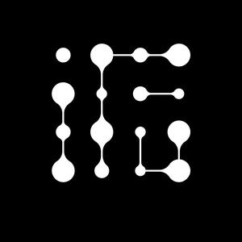

<p align="center">
  <a href="https://www.beyondata.com/">
    
  </a>
</p>

<h1 align="center">FF - FDE 交付工作台</h1>

<p align="center">
  <a href="https://github.com/fufankeji/FF-FDE-Delivery-Workbench/stargazers"></a>
  
  <a href="upstream/deepseek-harness.lock.json"></a>
  
  
</p>

<p align="center"><strong>面向 FDE 从业者，把企业 AI 项目从现场需求推进到验收交付。</strong></p>

<p align="center">八阶段交付 · 项目 Agent · 中文 Skills · 真实证据 · 人工决策</p>

<p align="center">在同一个项目中整理客户资料、与 Agent 协作开发、验证业务结果，并留下可追溯的产物与交付记录。</p>

<p align="center">
  <a href="#quick-start"><strong>快速开始</strong></a> ·
  <a href="#example-project"><strong>体验连锁门店示例</strong></a> ·
  <a href="DEPLOYMENT_AGENT.md"><strong>完整部署手册</strong></a> ·
  <a href="https://github.com/fufankeji/FF-FDE-Delivery-Workbench/archive/refs/heads/main.zip"><strong>下载源码</strong></a>
</p>

<p align="center">
  <a href="https://www.beyondata.com/">官方网站</a> ·
  <a href="https://github.com/fufankeji/FF-FDE-Delivery-Workbench/issues">问题反馈</a> ·
  <a href="https://github.com/fufankeji/deepseek-harness-studio">DeepSeek Harness Studio</a>
</p>

<p align="center"><sub>@赋范空间 独家研发</sub></p>

---

## 项目简介

FF - FDE 交付工作台服务于承担企业 AI 项目交付责任的 FDE（Forward Deployed Engineer）。从发现值得解决的业务问题，到明确范围、调查现场、开发验证、试点与验收，工作台把资料、对话、代码、阶段产物和人工决定组织在同一个项目中。

工作台使用 DeepSeek Harness 执行 Agent 任务，以项目目录隔离文件，以会话保留执行过程，以八阶段记录当前工作、证据缺口和下一步。你可以持续回到一个项目工作，而不必每次从一段新对话重新交代现场。

**Agent 负责协助调查、开发与验证；FDE 负责确认事实、批准关键动作和作出阶段决定。** 有文件、有图谱或服务启动成功，都不等于业务目标已经通过验收。

当前以完整源码和本地 Web 工作台交付。安装、浏览项目材料和查看示例不需要模型密钥；与 Agent 对话、运行模型评估或实验室访谈时，需要配置自己的模型服务。

## 核心功能

| 能力 | 你可以做什么 |
| --- | --- |
| 项目总览与项目中心 | 查看真实项目概况和最近工作，创建或选择项目，管理项目内的多条会话。 |
| 八阶段项目工作台 | 围绕当前阶段查看工作项、产物、证据与阻塞；回看历史记录，由 FDE 决定继续、修订或返回。 |
| 项目资料与本地识别 | 保存客户原件及来源标识，识别 DOCX、XLSX、PPTX、PDF、CSV、Markdown 和文本，并预览已有结果。 |
| 项目 Agent 与工程工作区 | 在当前项目中通过自然语言开展工作，结合文件、编辑器、Git Diff 和 Agent 文件审查查看实际修改。 |
| 中文 Skills 与技能中心 | 阅读、搜索和完整下载第一阶段七个内置中文 Skill；Agent 按需加载同一套维护文件，课程原版独立保留。 |
| 系统架构、API 文档与图谱 | 查看项目 API 文档，审阅和导出系统架构；确有业务需要时，使用 Semantica 路线维护语义定义、知识候选与项目图谱。 |
| 项目运行与调试 | 启动、停止和预览项目；只读查看 Agent 的运行输出，或在独立手动终端中排查问题。 |
| 用量分析与评估优化 | 汇总项目内会话及 Token 用量，组织验证方案、真实证据、评估报告和基线比较。模型评估需要单独确认费用。 |
| 独立业务挖掘实验室 | 在五个案例中练习岗位访谈、资料取证、计算和报告；不要求创建项目，也不改变项目阶段。需另行导入授权素材。 |
| 界面主题与个性化 | 切换内置皮肤、浅色或深色主题，以及仅保存在当前浏览器的自定义背景。 |

资料导入、识别、预览和页面切换不会自动发送 Agent 消息。项目资料的 OCR、版本/删除管理、权限/有效性管理和对话显式引用尚未形成完整功能。

## 从需求到交付，八个阶段怎么用

阶段表示项目当前承担的交付责任，不是自动完成的进度条。各阶段都有自己的工作面和记录，工程工具则按任务需要使用。

| 阶段 | 要回答的问题 | 组织的工作与结果 |
| --- | --- | --- |
| 01 · 发现高价值问题 | 真实问题是什么，值得做吗？ | 原始材料、岗位访谈、候选工作流、价值判断与证据缺口。 |
| 02 · 定义结果、范围与责任 | 做到什么算成功，由谁负责？ | 业务目标、成功标准、范围边界、责任人和交付安排。 |
| 03 · 调查数据、系统、接口、安全与组织 | 现场条件是否支持这件事？ | 数据与系统现状、接口约束、安全条件、组织协作及可执行边界。 |
| 04 · 设计方案并完成端到端纵向切片 | 用什么机制把关键链路跑通？ | 开发规格、系统架构与最小切片；必要时增加本体和知识图谱。 |
| 05 · 运行 PoC 与 Eval | 开发出的系统是否达到目标？ | 在 Agent 对话中开发联调，保留受测版本、运行入口、指标、证据和验证结论。 |
| 06 · 企业集成、可靠性改造与受控 Pilot | 能否在明确边界内进入现场试点？ | 集成条件、可靠性检查、试点范围、人工接管与恢复安排。 |
| 07 · 进入生产、推动采用并验收交接 | 谁接收，如何使用，怎样逐项验收？ | 发布与采用记录、验收条件、交接材料和接收责任。 |
| 08 · 持续改进并沉淀可复用能力 | 上线后如何持续解决现场问题？ | 改进事项、修复与回归证据、发布记录和复盘材料。 |

回看历史或未来阶段只改变浏览位置，不推进项目；它展示当前可读取的材料，不代表历史冻结快照。试点、生产发布、客户签收等事实必须有真实授权和证据，不能由 Agent 代为确认。

<a id="example-project"></a>

## 先体验一个完整案例：连锁门店设备故障分诊

仓库附带“连锁门店设备故障智能分诊项目”。它使用普通项目的文件、阶段与工作台入口，适合先理解完整交付链，再创建自己的项目。

导入后可以查看：

- **35 份客户仿真原件**及其来源索引、已有解析内容。
- **第一至第八阶段的产物和记录**，包括一轮持续改进记录。
- **56 个实体、56 条关系的知识图谱快照**，以及相关语义定义、构建和验证记录。
- **可本地运行的维修业务系统源码**，以及架构、测试和历史交付材料。

建议按这条路线体验：

1. 从介绍首页点击“进入平台”，在“项目中心”打开示例项目。
2. 示例载入位置是第八阶段；先回看第一阶段，了解原始资料、业务问题与判断依据。
3. 打开第四阶段，查看系统架构、语义定义与已有图谱；再到第五阶段查看受测版本和验证证据。
4. 按下方说明启动业务系统，体验报修分析、证据查看和本地草稿保存。
5. 查看试点、验收交接与改进记录，理解哪些结果由 Agent 产生，哪些决定必须由 FDE 作出。

> 示例使用脱敏仿真数据，部分记录是用于验证交付流程的联调输入，不代表真实客户已上线或签收。导入不重新执行历史测试，也不包含作者的私人会话或模型凭证。

### 运行示例业务系统

先完成[快速开始](#quick-start)中的示例导入。在新终端中，从仓库根目录执行：

```bash
cd .runtime/fde-agent-sample/project
node backend/server.mjs
```

打开 <http://127.0.0.1:4177>，选择报修 `R-1002`，依次查看分析、关联与证据，并保存本地草稿。这个示例使用本地规则和已有图谱快照，不需要模型密钥或额外业务依赖。端口冲突时可设置 `REPAIR_PORT=4178`。

工作台和业务系统是两个进程。单独启动业务系统不会自动更新工作台中的运行登记；正式派单、通知客户或费用承诺也不属于这个示例的自动动作。素材组成、导入边界与更新方法见 [FDE-Agent 素材说明](source-materials/fde-agent/README.md)。

## 中文 Skills：把方法带进实际工作

第一阶段内置七个方法，覆盖工作流筛选、现场定向、知识访谈、责任梳理、代码调查、干系人沟通和范围重审。Agent 根据当前问题选择需要的方法，不要求一次加载全部。

“技能中心”提供名称、完整中文正文、配套引用和完整文件下载；展示内容、下载包和 Agent 原生加载来自同一套维护文件。课程原版内容与平台方法分开保留，阅读和下载本身不会执行模型任务。

Skill 帮助组织工作，不替代现场证据，也不授予额外权限。阶段产物仍属于当前项目，阶段决定仍由 FDE 确认。

## 业务挖掘实验室：独立练习，不改动项目

从一级侧栏进入“实验室”，可选择财务、制造、运营、内部服务和物流五个案例，进入岗位访谈、获得授权资料、核对证据、完成计算并查看报告与历史。

打开大厅、选择岗位和恢复记录不调用模型；提交访谈、证据核对与报告生成可能产生模型费用。实验室使用独立模型路由，不跟随项目中的模型选择；同一服务共享每个案例的当前训练轮次，不提供个人账号或班级隔离。

实验室素材不随源码公开分发。取得授权的 `0.3.2` 完整交付 ZIP 后，在 `upstream/deepseek-harness/` 执行：

```bash
corepack pnpm --filter @deepseek-ai/dsh-fde-discovery-lab import:assets /absolute/path/to/FDE-业务挖掘实验室-完整交付-v0.3.2-2026-09-15.zip
```

缺少素材时，实验室会提示未就绪，其他模块仍可使用。安装、Python、模型路由和训练数据保留说明见[实验室包说明](upstream/deepseek-harness/packages/fde/discovery-lab/README.zh.md)。

<a id="quick-start"></a>

## 快速开始

推荐先导入示例，熟悉工作台后再创建自己的项目。以下命令用于**新克隆目录**，适用于 macOS/Linux Shell；Windows、源码 ZIP、已有运行区迁移及完整验收步骤见 [Agent 部署手册](DEPLOYMENT_AGENT.md)。

### 环境要求

- 推荐 **Node.js 24+**；Harness 声明支持 `^22.19.0 || >=24.0.0`，实验室按 Node.js 24+ 使用。
- **Corepack**，按工程声明调用 **pnpm 11.28.5**。
- 首次安装和构建需要网络；模型密钥不是安装与浏览的前置条件。
- 使用实验室需 Python 3.9+ 与授权素材；重新运行 Semantica 需单独准备其运行环境。

### 1. 获取源码并导入示例

```bash
git clone https://github.com/fufankeji/FF-FDE-Delivery-Workbench.git FDEDeliveryWorkbench
cd FDEDeliveryWorkbench

node source-materials/fde-agent/load.mjs
```

导入器校验文件摘要、恢复资料修改时间，并在 `.runtime/fde-agent-sample/` 创建独立的项目副本和运行区。目标已存在时会拒绝覆盖；不要反复执行导入来替代重启。后续使用同一个运行区即可。

### 2. 安装与构建

```bash
cd upstream/deepseek-harness
corepack pnpm install --frozen-lockfile
corepack pnpm run build
```

OpenAPI 依赖已以固定本地包放在 `third-party/dsh-openapi/`，随源码提供；不需要访问原作者的私有 GitHub 仓库。请保留该目录、许可证和锁文件。

### 3. 启动工作台

```bash
DSH_HOME="$PWD/../../.runtime/fde-agent-sample/dsh-home" \
  corepack pnpm dsh web --no-open --host 127.0.0.1 --port 3080
```

首次打开终端打印的**带授权参数链接**，建立浏览器 Cookie 后，才可直接访问 <http://127.0.0.1:3080>。进入项目中心后应能看到“连锁门店设备故障智能分诊项目”；首次进入会创建自己的会话。

页面不会自动弹出“预览版说明”或“开始使用”。账号登录与 API Key 配置仍可主动打开；它们与工作台的浏览器访问授权是两回事。

<details>
<summary>只想从空白项目开始？</summary>

跳过示例导入，在完成安装与构建后，从 `upstream/deepseek-harness/` 使用独立运行区启动：

```bash
DSH_HOME="$PWD/../../.runtime/dsh-home" \
  corepack pnpm dsh web --no-open --host 127.0.0.1 --port 3080
```

如果该运行区已存在，会复用其中的数据，不会变成空白实例。不要删除已有目录来清空项目；新实例应使用新的明确路径。

</details>

### 外部服务准备

| 服务或资源 | 什么时候需要 | 如何准备 | 费用与边界 |
| --- | --- | --- | --- |
| DeepSeek 或其他兼容模型服务 | 与项目 Agent 对话、执行模型任务 | 在工作台设置中配置自己的提供方、模型与 API Key，或使用账号入口 | 依提供方计费；资料可能发送至所选服务，使用前确认授权。 |
| 实验室授权素材与模型路由 | 使用完整实验室案例和访谈 | 导入交付 ZIP，按实验室包说明配置 Provider/Model | 访谈、核对、报告可能计费；素材需另行获得授权。 |
| Semantica 0.6.7 | 重新抽取、构建或验证本体路线 | 安装兼容 SDK，并配置 `FDE_SEMANTICA_PYTHON` 与 `FDE_SEMANTICA_SOURCE` | 查看已有图谱不需要 SDK；当前集成规则管线不要求模型密钥。 |

凭证保存在实际使用的本地运行区，不写入源码、提交或公开日志。不要复制作者或其他项目的凭据。查看文件、浏览已有阶段材料和运行附带业务示例，可以先不配置模型。

<a id="agent-setup"></a>

## 让你的 Agent 帮你跑起来

把完整源码交给 Codex、Claude Code 等编程 Agent，并提供下面的任务说明。部署细节以 [DEPLOYMENT_AGENT.md](DEPLOYMENT_AGENT.md) 为准；[AGENTS.md](AGENTS.md) 记录项目约束，[CLAUDE.md](CLAUDE.md) 提供兼容入口。

```text
请先阅读这个项目的 AGENTS.md 和 DEPLOYMENT_AGENT.md。
目标：在我的电脑上启动 FF - FDE 交付工作台，并导入附带的连锁门店示例。

先检查环境、源码完整性、端口和已有运行数据，说明要使用的 DSH_HOME。
按锁文件安装和构建，只向不存在的新目录导入示例。
使用显式 DSH_HOME 启动本机服务，完成无密钥检查后交给我手动体验。

不要读取或复制已有凭据，不调用付费模型，不覆盖运行数据，
不开公网、不自动做浏览器回放。缺少实验室素材时明确说明，不伪造可用。
```

## 系统架构与源码导读

工作台是 **Harness 基座 + FDE Host/Client 插件**的组合。浏览器负责项目与阶段交互，Host 负责项目数据、工具及授权，Agent 执行复用 Harness；本项目不另写一套 Agent Loop。

### 目录结构

```text
FDEDeliveryWorkbench/
├── upstream/
│   ├── deepseek-harness.lock.json       # 精确基座版本与提交
│   └── deepseek-harness/
│       ├── apps/web/                   # Web 应用入口
│       ├── packages/bundle/web-app/    # 工作台插件组合
│       ├── packages/client/ui-fde-*/   # 项目、阶段、实验室等界面
│       ├── packages/fde/              # 项目、资料、阶段、图谱等 Host 能力
│       └── third-party/dsh-openapi/   # 固定本地 OpenAPI 依赖
├── source-materials/fde-agent/         # 仿真示例、清单与导入器
├── frontend/public/brand/             # FF 品牌资产
├── docs/                             # PRD、规格、架构与验证记录
├── .runtime/                         # 本地运行数据，不进入 Git
├── AGENTS.md                         # 项目开发约束
└── DEPLOYMENT_AGENT.md                # 部署与验收操作手册
```

按下面的顺序读代码即可找到主链路：

1. [Web 插件组合](upstream/deepseek-harness/packages/bundle/web-app/cordis.patch.yml)：哪些官方能力与 FDE 插件被加载。
2. [项目 Client 入口](upstream/deepseek-harness/packages/client/ui-fde-project/src/client/index.ts)：界面注册、项目操作与视图切换。
3. [项目 Host 入口](upstream/deepseek-harness/packages/fde/project/src/index.ts)：项目快照、架构、运行与交付能力。
4. [阶段与方法](upstream/deepseek-harness/packages/fde/stage/src/index.ts)：当前阶段、方法路由与人工推进边界。
5. [资料能力](upstream/deepseek-harness/packages/fde/source/src/index.ts)：原件、来源索引和本地识别。
6. [示例导入器](source-materials/fde-agent/load.mjs)：可分发素材如何变成接收者自己的项目。

当前核心技术为 React、TypeScript、Vite、Cordis 与 DeepSeek Harness；实验室计算和 Semantica 集成按需使用 Python。项目文件与运行状态保存在本地，模型服务是否外发由实际提供方决定。

## 测试与开发

在仓库根目录检查示例导入和业务流程：

```bash
node --test source-materials/fde-agent/load.test.mjs
node --test source-materials/fde-agent/project/backend/tests/workflow.test.mjs
```

工作台构建与相关测试从 Harness 目录执行：

```bash
cd upstream/deepseek-harness

# 构建制品，并检查 Host / Client 类型
corepack pnpm run build

# 本次自动引导行为的定向回归；不调用模型
corepack pnpm exec vitest run packages/client/ui-settings-models/tests/apply.client.spec.ts packages/client/ui-settings-models/tests/onboarding-dialog.client.spec.tsx packages/bundle/web-app/tests/onboarding-defaults.spec.ts
```

按改动范围选择测试，不把示例历史报告当成当前机器的验证结果。开发规范与中文规格链见 [AGENTS.md](AGENTS.md)；本次 Harness 升级的实际构建、定向测试和剩余人工验收项见[验证记录](docs/verification/2026-10-23-harness-021-compatibility.md)。

## 数据保留、更新与局域网访问

- **每次启动都显式指定同一个 `DSH_HOME`。** 不省略它，不误读全局或其他项目运行区。
- **Git 同步源码，不同步你的业务数据。** `.runtime/` 不进入 Git；项目文件、会话、训练记录和业务草稿需要自行保留，不能一概作为缓存删除。
- **示例更新不覆盖已导入副本。** 新素材可导入新目录；旧副本有个人修改时先保留，不通过重签摘要“修复”失效证据。
- **新版先在隔离副本验证。** 官方会话迁移保留旧代原件；代码回退不等于数据回退。具体流程见[基座升级说明](docs/architecture/harness-021-upgrade.md)。
- **局域网使用具体 IP 与浏览器授权。** 通过 `--host` 指定本机实际局域网 IP，每台获准设备使用启动授权链接；旧 `--lan` 已退役，不开放公网。独立 `*.localhost` 项目预览仍是本机能力。
- **手动终端与 Agent 共用项目文件和端口。** 人工命令不会自动记入 Agent 对话，改变服务后需重新核验运行状态。

局域网启动示例（从 Harness 目录执行，将 IP 替换为本机真实地址）：

```bash
DSH_HOME="$PWD/../../.runtime/fde-agent-sample/dsh-home" \
  corepack pnpm dsh web --no-open --host 192.168.1.100 --port 3080
```

仅监听指定地址，不保证同时能通过 `127.0.0.1` 访问。不要公开终端中的授权链接；它属于访问凭据。

## 常见问题

**打开 127.0.0.1:3080 显示需要认证？**

先打开本次启动日志中的带授权参数链接，再使用普通地址。关闭自动登录引导不代表取消工作台访问授权。

**安装时还需要私有 dsh-openapi 仓库权限吗？**

不需要。本版本使用随源码分发的固定本地包；确认克隆或解压时没有漏掉 `third-party/dsh-openapi/`。

**没有 API Key 能体验什么？**

可以浏览项目、资料、阶段材料、已有图谱，并运行附带的维修业务系统。Agent 对话、实验室访谈和模型评估需要自己的模型配置与调用授权。

**为什么实验室提示缺少素材？**

完整案例素材需要独立授权与导入，不包含在公开源码内。无需素材即可使用工作台其他功能。

**为什么有报告或图谱，阶段仍未完成？**

文件存在、结构校验通过、业务验证通过与人工验收是不同事实。先核对当前版本的真实证据，再由 FDE 作出决定。

## 与 DeepSeek Harness、Studio 的关系

本项目由赋范空间维护，是基于 [DeepSeek Harness](https://github.com/deepseek-ai/deepseek-harness) 的独立 FDE 工作台，不是 DeepSeek 官方发行版。当前锁定 `0.2.1-rc.2`，版本与提交以[基座锁定文件](upstream/deepseek-harness.lock.json)为准；不会自动跟随官方主分支升级。

同属赋范空间的 [DeepSeek Harness Studio](https://github.com/fufankeji/deepseek-harness-studio) 聚焦通用桌面增强、插件与 Preset 生态；本项目聚焦一个企业 AI 项目从业务发现到验收交接的持续工作。两者是不同产品，不将 Studio 的桌面安装包、插件市场或本地模型入口作为本工作台的已交付能力。

## 配套文档

- [完整部署手册](DEPLOYMENT_AGENT.md)：Git/ZIP、macOS/Linux/Windows、模型配置、数据保留与验收。
- [产品需求](docs/PRD.md)与[产品总规格](docs/specs/product-spec.md)：范围、共享行为与验收依据。
- [架构说明](docs/architecture/architecture.md)：FDE 与 Harness 的职责划分。
- [基座升级与回退](docs/architecture/harness-021-upgrade.md)：版本升级、隔离验证和恢复条件。
- [FDE-Agent 素材](source-materials/fde-agent/README.md)：案例内容、导入、运行与更新。
- [Semantica 集成](upstream/deepseek-harness/packages/fde/semantica/README.zh.md)：本体路线、SDK 和模型边界。

## 许可说明

当前仓库未设置统一的根目录许可证。上游基座和第三方内容各自保留许可声明，参见 [Harness LICENSE](upstream/deepseek-harness/LICENSE)、[第三方声明](upstream/deepseek-harness/THIRD_PARTY_NOTICES.md)及相应包目录。平台 Skill 下载包保留必要许可文件；实验室素材的授权与源码访问分开管理。

---

<p align="center"><strong>@赋范空间 独家研发</strong></p>
